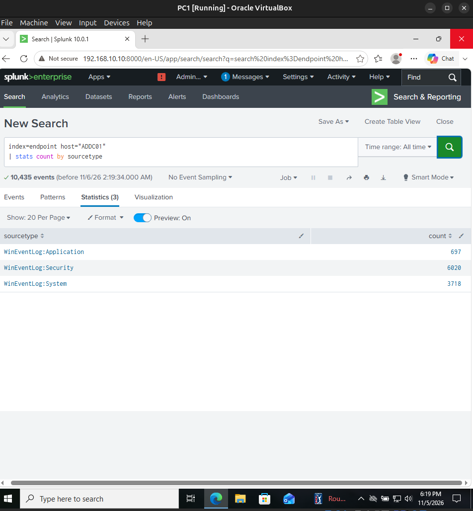
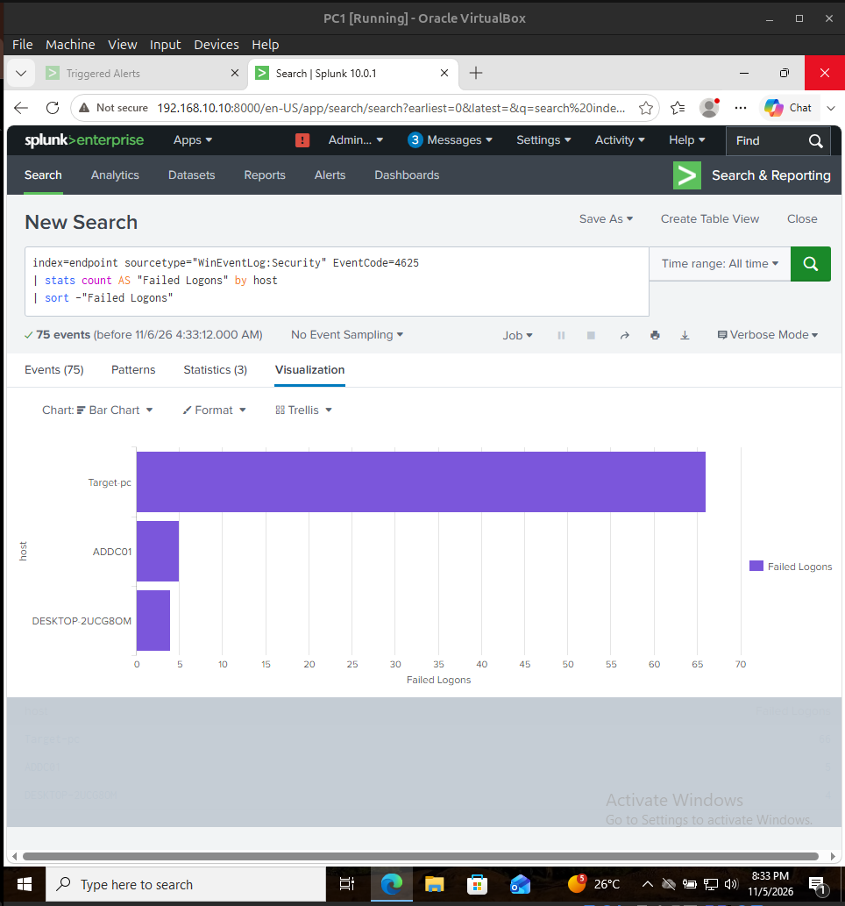
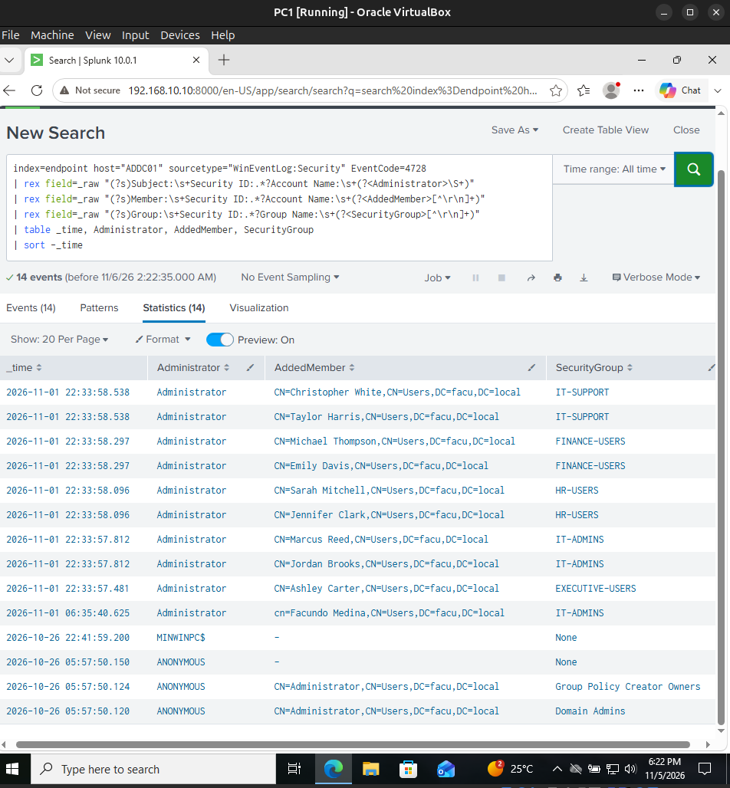
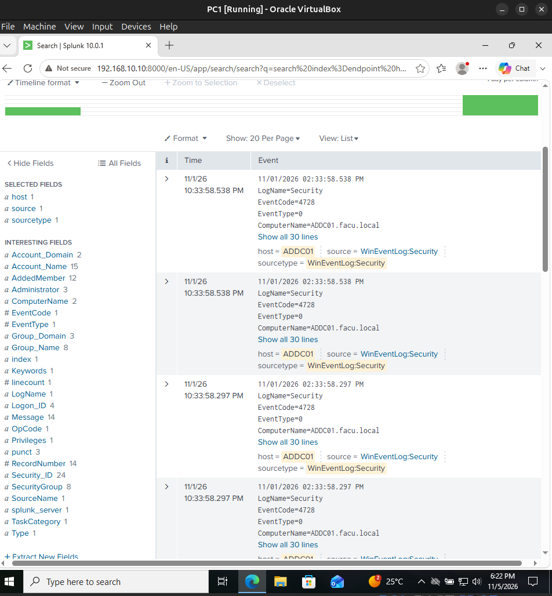
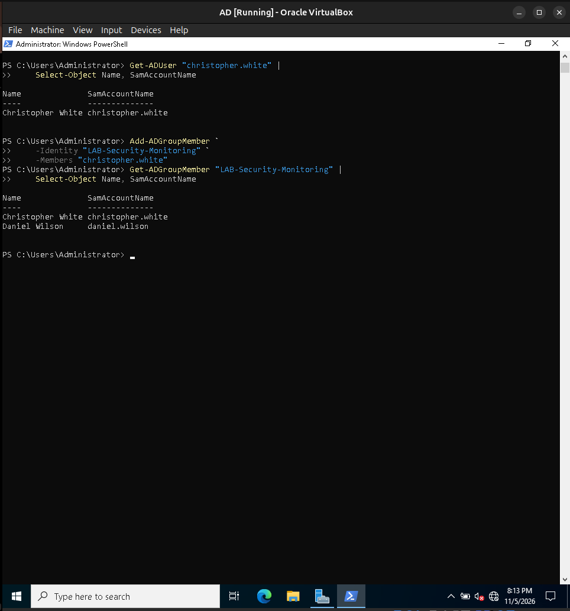
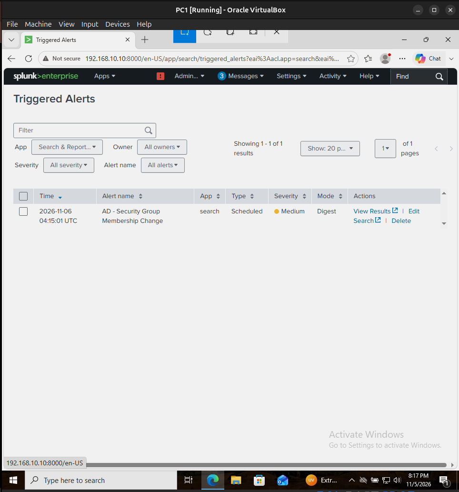
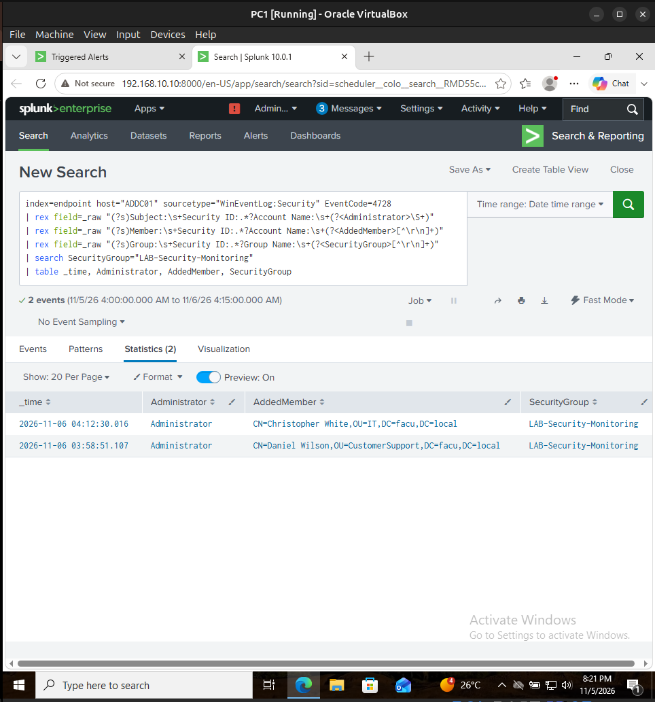
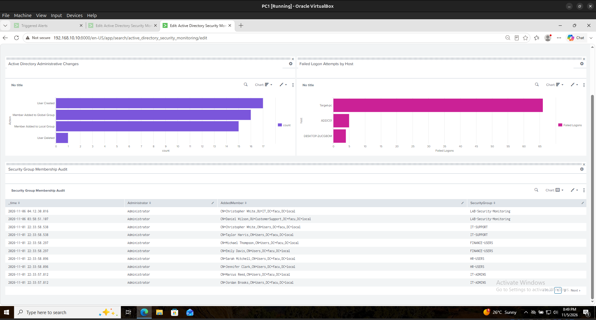

# Active Directory Security Monitoring with Splunk

A hands-on Windows security monitoring lab built on an existing Active Directory environment. Windows events were collected with Splunk Universal Forwarder, investigated with SPL, and used to validate a scheduled detection for changes to Active Directory security groups.

> **Scope:** Home lab / authorized test environment. Events and screenshots are from lab systems. A triggered alert indicates a matching administrative change, **not** a confirmed security incident.

## Lab architecture

| System | Role | Lab address |
|---|---|---|
| ADDC01 | Windows Server 2022; AD DS and DNS; Windows Security, System and Application event source | `192.168.10.7` |
| TARGET-PC | Domain-joined Windows 10; Windows Event Logs and Sysmon | `192.168.10.100` |
| Splunk | Linux-hosted Splunk Enterprise 10.0.1; collection, searches, scheduled alert, dashboard | `192.168.10.10` |

**Data flow:** ADDC01 / TARGET-PC → Splunk Universal Forwarder → TCP 9997 → Splunk Enterprise (`index=endpoint`) → SPL searches → scheduled alert and dashboard. Splunk Web is accessed on TCP 8000.

`DESKTOP-2UCG80M` also appears in historical data, but was not independently established as a third physical/virtual endpoint.

This lab extends the earlier [Active Directory Enterprise Lab](https://github.com/FacundoMedina2320/active-directory-enterprise-lab), which documented the domain, organizational units, security groups, GPOs and troubleshooting.

## Objectives

1. Centralize event logs from a domain controller and Windows client.
2. Investigate failed authentication using **Windows Event ID 4625**.
3. Audit AD security group membership additions using **Event ID 4728**.
4. Generate an authorized, controlled group-membership change and validate end-to-end detection.
5. Build a reusable Splunk dashboard and scheduled alert.

## Implementation and validation

### 1. Event collection

Splunk Enterprise was verified running with listeners on TCP **8000** and **9997**. The Universal Forwarder on ADDC01 was installed and connected to `192.168.10.10:9997`. Windows **Security**, **System**, and **Application** logs were ingested into the `endpoint` index. The client also forwarded Sysmon events.

The lab configuration example is available at [configuration-examples/inputs.conf](configuration-examples/inputs.conf). It deliberately does not include Sysmon for ADDC01, because installation on that server was not validated.

### 2. Failed logon investigation — Event 4625

SPL search: [failed-logons.spl](splunk-queries/failed-logons.spl).

In a historical **All time** search, 75 failed-logon records appeared across the indexed host labels: **66 Target-pc**, **5 ADDC01**, and **4 DESKTOP-2UCG80M**. These are recorded Windows events, not proof of 75 separate attack attempts. The `DESKTOP-2UCG80M` label may represent earlier machine history.

A separate investigation found network logon failures associated with source `192.168.10.250` (the Kali lab address), including the `jsmith` test account; these records were treated as lab authentication failures rather than confirmed malicious activity.

### 3. AD group membership audit — Event 4728

Windows Security Event **4728** records an addition to a security-enabled global group. A raw ADDC01 event was examined to identify the actor (**Subject**), added account (**Member**) and affected group (**Group**).

Some parsed Splunk fields were ambiguous or blank. I used targeted `rex` extractions from `_raw` to produce consistent `Administrator`, `AddedMember`, and `SecurityGroup` columns. The exact SPL is in [group-membership-audit.spl](splunk-queries/group-membership-audit.spl). These expressions match the observed English text event format and may need adjustment for localized or XML-formatted logs.

### 4. Controlled test

A dedicated **global security group**, `LAB-Security-Monitoring`, was created in the lab domain. The test accounts `daniel.wilson` and `christopher.white` were added with PowerShell and verified using `Get-ADGroupMember`.

The corresponding two Event 4728 records appeared in Splunk, with `Administrator` as the actor, each user's distinguished name, and `LAB-Security-Monitoring` as the affected group.

### 5. Scheduled alert

**Alert:** `AD - Security Group Membership Change`

- Query: Event 4728, filtered to `LAB-Security-Monitoring`.
- Schedule: cron `*/5 * * * *` (every five minutes).
- Search window: the previous 15 minutes in the tested configuration.
- Trigger: number of results greater than zero; action **Add to Triggered Alerts**.
- Validation: a triggered alert was recorded on 6 November 2026. Viewing the scheduled search results showed both controlled membership additions.

**Limitation:** the 15-minute window overlaps with a five-minute schedule, so an event may appear in multiple runs; production deployment would require adjusted lookback and suppression/deduplication. This is a *scheduled* detection, not a real-time stream rule.

### 6. Security monitoring dashboard

The dashboard **Active Directory Security Monitoring** contains:

- **Active Directory Administrative Changes:** Windows events 4720 (user created), 4726 (user deleted), 4728 (member added to global group), 4732 (member added to local group).
- **Failed Logon Attempts by Host:** Event 4625 grouped by indexed host.
- **Security Group Membership Audit:** timestamp, administrator, member and affected group for Event 4728.

The pictured dashboard was captured in edit mode. Counts are historical for the selected time range, not a live threat score.

## SPL searches

| File | Purpose |
|---|---|
| [failed-logons.spl](splunk-queries/failed-logons.spl) | Failed logons per host |
| [group-membership-audit.spl](splunk-queries/group-membership-audit.spl) | Account added, administrator, group |
| [administrative-changes.spl](splunk-queries/administrative-changes.spl) | Count AD management operations |
| [scheduled-group-alert.spl](splunk-queries/scheduled-group-alert.spl) | Scheduled test group alert |
| [indexing-latency.spl](splunk-queries/indexing-latency.spl) | Compare event time and ingestion time |

## Troubleshooting and lessons learned

- A running Universal Forwarder and an active connection do not guarantee log ingestion. ADDC01 initially had no `WinEventLog` inputs configured; adding the correct `inputs.conf` entries and restarting its service enabled collection.
- The raw Event 4728 text was more dependable than initially assumed extracted field names; the SPL uses explicit field extraction to make the audit table readable.
- The scheduled alert did not appear immediately. The event-time versus indexed-time investigation showed approximately one second of indexing delay for the two controlled changes; a later scheduled run successfully fired.
- In a production environment: minimize forwarder permissions, use encrypted forwarding, validate audit policies, handle timezone consistency, establish alert deduplication and retention, and avoid exposing identifiable or sensitive log contents.

## Reproduce the demonstration

1. In an isolated, authorized AD lab, install and configure a Splunk receiver and Universal Forwarders.
2. Enable relevant Windows Security logs and confirm ingestion by host/sourcetype.
3. Run the queries in `splunk-queries/`.
4. Create a *dedicated nonprivileged* security group; add a test account.
5. Verify Event 4728 on the domain controller, then confirm the ingested record in Splunk.
6. Configure a scheduled alert for that group, validate the trigger, and add the three dashboard panels.

## Evidence

Eight selected, real lab screenshots are available in the repository root and linked throughout this README. No credentials, tokens or live external endpoints are included.

---
**Tools:** Windows Server 2022 · Active Directory DS · Windows 10 · Splunk Enterprise 10.0.1 · Universal Forwarder · Sysmon (client) · PowerShell · SPL · VirtualBox.
